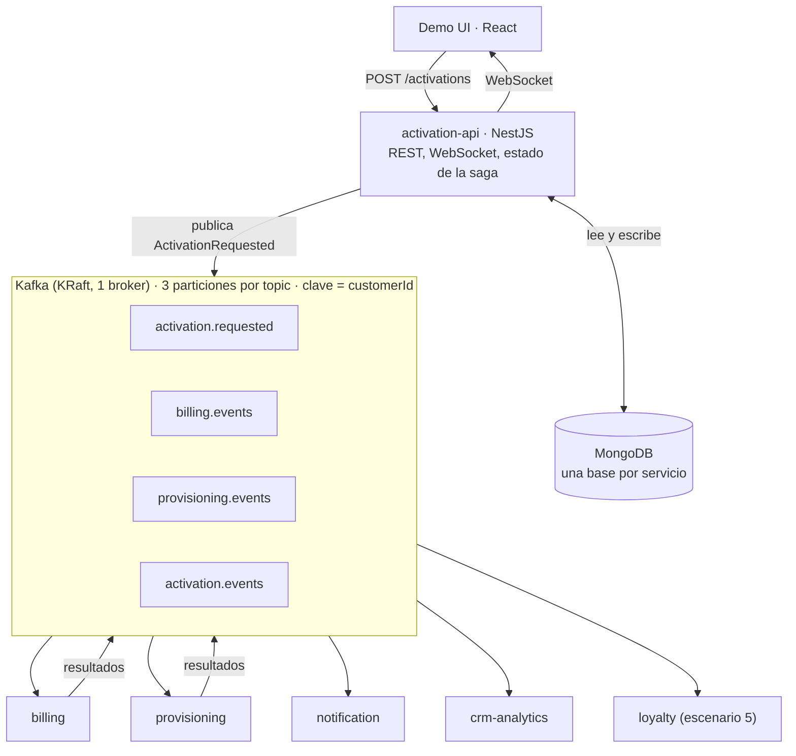
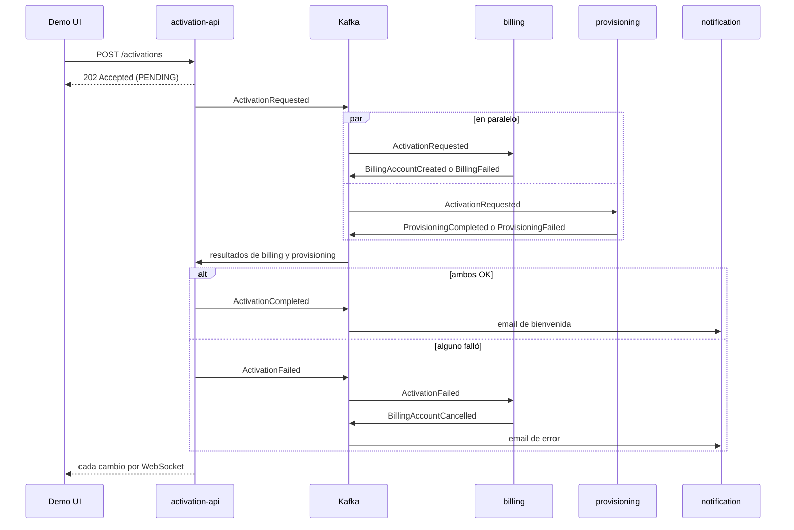

# Arquitectura

La activación de un plan se resuelve publicando un único evento en Kafka. `activation-api` es el único punto de entrada; todo lo demás reacciona a eventos.

## 1. Vista general



Billing y provisioning trabajan **en paralelo** sobre el mismo evento y publican su resultado. `activation-api` junta ambos y decide si la activación terminó bien o mal (coreografía con un agregador, sin orquestador).

## 2. Stack

| Componente | Tecnología |
|---|---|
| Mensajería | Apache Kafka 3.9 en modo KRaft, 1 broker |
| Servicios | NestJS 12 + `@nestjs/microservices` (transporte Kafka sobre kafkajs) |
| Frontend | React + Vite + socket.io-client (tema Catppuccin) |
| Persistencia | MongoDB 7 en replica set de un nodo |
| Observabilidad | Kafka UI (kafbat) |
| Email simulado | Mailhog |
| Entorno | Docker Compose |
| Monorepo | Modo monorepo de Nest, con `libs/contracts` y `libs/kafka-toolkit` |

## 3. Topics y contratos

Cuatro topics de negocio más su DLQ cada uno. Todos con 3 particiones, retención de 7 días y `customerId` como clave del mensaje (garantiza orden por cliente).

| Topic | Eventos | Productor | Consumidores (consumer group) |
|---|---|---|---|
| `activation.requested` | `ActivationRequested` | activation-api | billing-svc, provisioning-svc, crm-analytics |
| `billing.events` | `BillingAccountCreated`, `BillingFailed`, `BillingAccountCancelled` | billing | activation-api, crm-analytics |
| `provisioning.events` | `ProvisioningCompleted`, `ProvisioningFailed` | provisioning | activation-api, crm-analytics |
| `activation.events` | `ActivationCompleted`, `ActivationFailed` | activation-api | notification-svc, billing-svc (compensación), crm-analytics, loyalty |
| `<topic>.dlq` | mensajes que no se pudieron procesar | el consumidor que falló | inspección manual en Kafka UI |

NestJS agrega el sufijo `-server` al nombre del grupo (por ejemplo `billing-svc-server`); es lo que se ve en Kafka UI.

Todos los eventos comparten el mismo sobre; el `payload` cambia según el tipo:

```json
{
  "eventId": "7c9e6679-7425-40de-944b-e07fc1f90ae7",
  "eventType": "ActivationRequested",
  "version": 1,
  "occurredAt": "2026-10-22T16:40:00Z",
  "correlationId": "act-0001",
  "customerId": "C-1234",
  "source": "activation-api",
  "payload": { "planId": "Plan Digital", "channel": "web", "simulateFailure": "none" }
}
```

| Campo | Uso |
|---|---|
| `eventId` | Identificador único del evento. |
| `eventType` + `version` | Permiten evolucionar el contrato sin romper consumidores. |
| `correlationId` | Es el `activationId`; agrupa todos los eventos de una activación. |
| `customerId` | También es la clave del mensaje en Kafka. |
| `source` | Servicio que publicó el evento. |
| `simulateFailure` | Solo para la demo: indica a billing o provisioning que deben fallar. |

Los contratos viven en `libs/contracts` (única fuente de verdad) y llevan versión (`EVENT_VERSION`). Convenciones: eventos en pasado, topics en `dominio.tipo`; los cambios compatibles suman campos opcionales y los incompatibles suben la versión.

## 4. Flujo de la activación



**Estados:** `PENDING` (al crear) → `IN_PROGRESS` (llegó el primer resultado) → `ACTIVE` (billing y provisioning confirmaron) o `FAILED` (alguno falló, con compensación).

**Regla de agregación en activation-api:** guarda el resultado de cada servicio en el documento de la activación. Con los dos OK publica `ActivationCompleted`; con el primer fallo publica `ActivationFailed` y los resultados posteriores solo se registran en el historial. Las transiciones de estado son atómicas en Mongo, así que dos eventos simultáneos no pueden finalizar la activación dos veces.

**Caso borde:** si provisioning falla antes de que billing cree la cuenta, billing puede recibir `ActivationFailed` antes de terminar. Billing deja un marcador de anulación y, si después crea la cuenta, la deja anulada.

## 5. Modelo de datos (MongoDB)

Cada servicio tiene su propia base; ninguno lee la base de otro.

| Base | Colección | Contenido | Índice |
|---|---|---|---|
| `activation` | `activations` | Estado de la activación, resultados parciales (`steps`) e historial de eventos | `_id` = activationId; `customerId` |
| `billing` | `billing_accounts` | Cuenta simulada por activación (`CREATED` o `CANCELLED`) | `activationId` único |
| `provisioning` | `provisioning_orders` | Orden simulada de aprovisionamiento | `activationId` único |
| `notification` | `notifications` | Emails enviados (`PENDING` o `SENT`) | `activationId` + `eventType` único |
| `crm` | `event_log` | Copia de cada evento recibido | `eventId` único; `correlationId` |
| `loyalty` | `loyalty_awards` | Puntos otorgados, uno por activación completada | `activationId` único |

## 6. Decisiones técnicas

**Coreografía con agregador.** Billing y provisioning reaccionan solos al evento; `activation-api` solo junta resultados. Es más simple que un orquestador que da órdenes y muestra mejor el desacople.

**Idempotencia a nivel de efecto.** Kafka entrega "al menos una vez", así que un consumidor puede recibir un mensaje repetido. Cada servicio evita duplicar el efecto con un índice único en su colección:

- billing y provisioning reutilizan la cuenta u orden existente en lugar de crear otra;
- notification no manda un segundo email si el de ese evento figura como `SENT`;
- crm guarda cada `eventId` una sola vez;
- loyalty otorga los puntos de una activación una sola vez;
- el agregador ignora resultados posteriores a la finalización.

**Reintentos y DLQ (en `libs/kafka-toolkit`).** Todos los consumidores pasan sus mensajes por `KafkaConsumerGuard`:

- Un mensaje que no tiene la forma de un evento va directo a `<topic>.dlq`, sin reintentos.
- Si el handler falla, se reintenta 3 veces con espera creciente (1 s, 2 s, 4 s). Si sigue fallando, el mensaje original se publica en `<topic>.dlq` y el consumidor continúa con el siguiente.
- La DLQ lleva en los headers: `dlq-original-topic`, `dlq-service`, `dlq-error`, `dlq-attempts` y `dlq-failed-at`.
- Cada servicio que consume el topic manda el mensaje a la DLQ por separado, así que un mensaje inválido en `activation.requested` aparece una vez por servicio.
- Los fallos de negocio simulados (`simulateFailure`) no son errores técnicos: se publican como `BillingFailed` o `ProvisioningFailed` y no van a la DLQ.

**Orden por cliente.** La clave del mensaje es `customerId`: los eventos de un mismo cliente caen en la misma partición y se procesan en orden. Por eso, para ver el reparto entre instancias (escenario 4), hay que usar clientes distintos.

**Replay del log.** Los consumer groups nuevos leen desde el inicio (`fromBeginning`). Es lo que permite sumar `crm-analytics` o `loyalty` sin tocar a los demás.

**Cliente Kafka aislado.** Todo el acceso a Kafka está en `libs/kafka-toolkit`, para poder reemplazar kafkajs (de mantenimiento limitado) sin tocar los servicios.

**Mongo en replica set de un nodo.** Se mantiene desde la fase 1 porque las transacciones lo requieren. Desde fuera de Docker las conexiones usan `directConnection=true`, porque el replica set se anuncia como `mongo:27017`.

## 7. Estado de implementación

Respecto del documento de arquitectura original:

| Elemento | Estado |
|---|---|
| UI de demo con formulario y timeline en vivo | Implementado |
| 5 servicios NestJS (activation-api, billing, provisioning, notification, crm-analytics) | Implementado |
| Kafka KRaft de un broker, Kafka UI, MongoDB, Mailhog | Implementado |
| Fallos forzados y compensación | Implementado |
| Reintentos (1 s, 2 s, 4 s) y DLQ | Implementado |
| Escenario 5 (`loyalty-service`, consumidor nuevo) | Implementado |
| `docker compose up` levanta todo | Implementado |
| Idempotencia | Implementada **a nivel de efecto**; no con la colección `processed_events` por `eventId` |
| Commit manual de offsets | No implementado: se usa el commit automático de kafkajs |
| Outbox transaccional (fase 4) | No implementado: se publica directo después de guardar |
| Schema Registry, OpenTelemetry (fase 4) | No implementado (fase opcional) |
| Pruebas automáticas | No incluidas: se verifica manualmente con los escenarios del guion |

### Limitaciones conocidas

- **Sin outbox:** si `activation-api` guarda la activación y se cae antes de publicar, el evento se pierde y la activación queda en `PENDING`. Si falla la publicación, la API responde 503.
- **Eventos repetidos:** cuando un mensaje se reentrega, los servicios no duplican el efecto, pero sí republican su evento de resultado. El agregador lo ignora, pero queda registrado dos veces en `event_log` y en el historial de la activación. La idempotencia por `eventId` lo evitaría de raíz.
- **Reintentos en línea:** mientras se reintenta un mensaje (hasta unos 7 s más el retardo de provisioning), ese consumidor no procesa los demás mensajes de su partición.
- **Un solo broker:** no hay alta disponibilidad ni réplicas.
